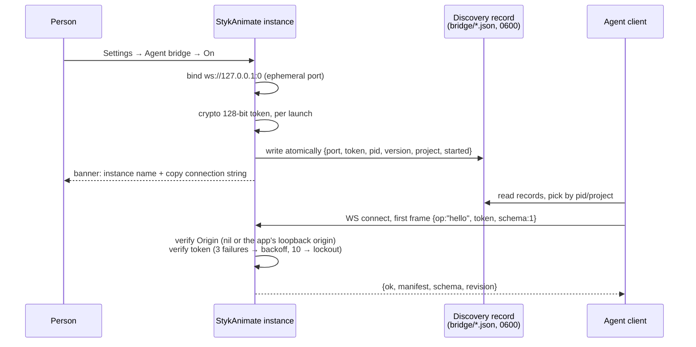

# Agent bridge (design)

*Status: transport, dispatcher and desktop wiring implemented; the render/snapshot observe paths are the next milestone. See the milestone sections for what exists.*

## Milestone 1 — transport host (implemented)

`src/agent-bridge/host.mjs` implements the loopback transport the rest of the bridge builds on, with nothing inside calling the editor yet:

- `AgentBridgeHost.start()` binds `127.0.0.1` on an ephemeral port, generates the per-launch 128-bit token and writes the discovery record before answering any upgrade. `stop()` closes clients with a grace period, terminates laggards and removes the record.
- Upgrades verify the host header (loopback literals only), the origin (nothing, `null`, or the app's own loopback origin) and the connection budget before `ws` takes the socket; broken keys are rejected by `ws` itself with 400.
- The first frame must say `hello`: wrong token → 4401 with a delay after repeated failures, ten failures → 4403 lockout for sixty seconds, wrong schema → 4409, malformed or silent → 4400.
- Records live in `~/.styk-animate/bridge/` as `instance-<pid>.json`, written atomically with 0600; `sweepStaleRecords()` prunes files whose PID is gone.
- `ws@8.22.0` moved from devDependencies to dependencies for the packaged app.

Tests: `npm run test:agent-bridge` (alias `tests/agent-bridge-host.test.mjs`), covering record lifecycle, token auth and lockout, origin/host gates, close codes and the sweep.

## Milestone 2 — manifest from the command catalog (implemented)

`src/agent-bridge/manifest.mjs` builds the schema-v1 manifest from `HOTKEY_COMMANDS` by construction: one entry per catalog command in catalog order, carrying `id`, `label`, `category`, `scope`, `defaults`, and the `repeat`/`hold`/`extraShift` flags. Runtime availability still lives with the dispatcher (milestone 3); the static manifest is what an agent reads to know the vocabulary. Repeated ids throw. The host includes the manifest in its hello reply when given one and stays minimal otherwise. Adding a catalog command flows into the manifest automatically; a schema bump is only needed when the manifest's *shape* changes, which is the contract the agents depend on.

Tests: `tests/agent-bridge-manifest.test.mjs` verifies the mirror is exact (ids, order, fields, scopes valid per `HOTKEY_SCOPES`), that duplicate ids are rejected, and that the hello reply carries the manifest.

## Milestone 3 — dispatcher and desktop wiring (implemented)

`src/agent-bridge/dispatcher.mjs` (`AgentDispatcher`) turns bridge messages into registry operations: `list` returns every registry command with live availability and reason strings, `invoke` runs one command the way a click would (`source: 'agent'`), `undo`/`redo` route through their own commands, and `render`/`snapshot`/`events` answer a clean "not supported yet" until the observe milestone. An unavailable command never reaches `run`; replies echo `seq` and carry editor status (`revision`, `canUndo`, `canRedo`, `historyDepth` — a new public `Editor` getter).

Shared constants moved to `src/agent-bridge/constants.mjs` so renderer-side modules never import `ws` (the desktop-only dependency stays in `host.mjs`).

Desktop wiring keeps the app's boundary shape:

- `desktop/main.cjs` starts and stops the host from the person's toggle, tags each connection with an id and relays messages to the workspace over `styk:agent-bridge-*` IPC handlers that keep the existing `trusted(event)` origin check. The token never crosses to the renderer; the hello reply is answered by the transport itself.
- `desktop/preload.cjs` exposes five narrow functions (`setAgentBridge`, `agentBridgeState`, `sendAgentBridgeMessage`, `onAgentBridgeMessage`, `onAgentBridgeClosed`) and nothing else.
- `src/app.mjs` builds one dispatcher over the app's own command registry and relays replies; the toggle flows through `EditorSettings.onChange`. The bridge is desktop-only: the Settings row (Interface → Assistant connection) does not render in a browser.
- `src/settings.mjs` adds the off-by-default `agentBridge` boolean to the persisted settings; `src/locales/en-features/settings.mjs` has its words.

Tests: `tests/agent-bridge-dispatcher.test.mjs` covers the list/invoke/undo/redo surface, the unavailable and failure paths, and that malformed or pending messages run nothing.

## Milestone 4 — observe paths (implemented)

The dispatcher accepts injected handlers; ops missing a handler stay honest "not supported yet" replies (the browser has none). `src/app.mjs` supplies them next to the glue:

- `render` asks the thumbnail worker for up to 8 frames by tick into an offscreen scene canvas, downscales to at most 512px on the long side and returns PNG data URLs. Its renderer is created lazily with the importer's base URL/token and shared per connection base, so the filmstrip's own LRU is untouched.
- `snapshot` returns a bounded overview — revision, tick, total ticks, fps, canvas size, background, layers, selection and up to 512 evaluated objects carrying only whitelisted native fields (`unique_id`, `figure_type_id`, position, scale, colour override, native transparency, and the figure name). No full-document serialization ever runs on this path.
- `seek` moves the playhead through the app's own `goToFrame` (1-based numbers, the timeline's own numbering).
- `events` subscribes one connection to editor change narration — throttled to at most one message per 100 ms, carrying revision, dirty state and undo status — and unsubscribes when the socket closes.

Tests: dispatcher delegation, async handler resolution, and failure envelopes are covered in `tests/agent-bridge-dispatcher.test.mjs`.

### Removal and porting

Everything the bridge owns lives in one place, so deleting it is mechanical:

| Owner | What |
| --- | --- |
| `src/agent-bridge/` | The whole module; the editor never imports it |
| `tests/agent-bridge-*.test.mjs` | Its tests |
| `package.json` | `ws` in dependencies and the `test:agent-bridge` script |
| `desktop/main.cjs` | The host lifecycle and relay handlers (`agentBridge*` functions, `styk:agent-bridge-*` IPC, one `will-quit` hook) |
| `desktop/preload.cjs` | The five `agent-bridge` bridge functions in `stykDesktop` |
| `src/app.mjs` | The `agentBridge*` glue right after `home.start()` (including the render/snapshot/seek/events handlers) and one `agentBridge` line in the settings change handler |
| `src/settings.mjs` | The `agentBridge` default and persisted-key entry |
| `src/locales/en-features/settings.mjs` | Three `settings.assistant`/`settings.agentBridge*` messages |

Future wiring (settings toggle, dispatcher registration in `app.mjs`) lands as additive hooks listed in this table, so the app never carries a sprawl of bridge conditions. Deleting the module, its test file and those hooks restores the exact upstream behavior and keeps fork merges conflict-free.

The agent bridge is an opt-in, self-contained module that lets an external agent — any AI or script — work in the editor the same way a person does: discover what can be done, perform edits, look at the rendered result, and revise. The person gives creative direction; the agent does the work. The bridge follows the same principle as the command palette: it is a client of the command catalog, never a second editing path.

## Goals and constraints

- Cover the great majority of a person's editing ability: add, pose, keyframe, tween, arrange, join, camera, VFX, movieclips, import, save and export.
- Stay decoupled from release churn. The contract is the stable command catalog plus a versioned schema; app updates that keep those stable do not break agents.
- Local only. Agent actions run in the user's own editor on the user's machine. The app's existing rule stands: remote processing of user projects requires an explicit product requirement. The bridge adds no hosted service.
- Off by default. Ship it as a Settings toggle; release-training risk stays near zero while the app is still releasing.
- One owner of behavior. The bridge calls the same wrapped `actions` map a click uses. Palette, hotkeys and agents are three clients of one contract; availability gating, Build-session rules and undo semantics are never duplicated or bypassed.

## Contract (schema v1)

Three halves, one schema:

### 1. Discover

One request the agent makes first; the answer changes only when the schema version changes.

```jsonc
{
  "bridge": "styk-agent", "schema": 1,
  "commands": [
    { "id": "addFigureInFrames",
      "args": { "typeId": "string", "indices": "number[]",
                "x": "number", "y": "number" },
      "available": true, "unavailableReason": null },
    { "id": "exportFrame", "available": true },
    { "id": "builderFinish", "available": false,
      "unavailableReason": "In Build" }
  ]
}
```

`unavailableReason` carries the same wording the command palette shows ("In Build", "Select a figure first"), so agents handle denied actions exactly like a user reading the one message line. The manifest is generated from the command catalog, never hand-maintained.

### 2. Invoke

One message in, one outcome out. Every mutation is a history entry, so agent mistakes are one undo away.

```jsonc
→ { "v": 1, "seq": 12, "op": "invoke",
    "command": "addFigureInFrames",
    "args": { "typeId": "stick-figure", "indices": [4, 5], "x": 200, "y": 120 } }

← { "v": 1, "seq": 12, "ok": true,
    "changedFrames": [4, 5], "historyDepth": 7 }
```

`historyDepth` counts undo steps, letting an agent measure and roll back its own attempts. Undo and redo are ordinary operations. The desktop build also answers `seek` (1-based frame), `snapshot` (bounded scene overview), `render` (frame previews as PNG data URLs) and `events` (edit narration per connection).

### 3. Observe

How the agent sees and judges its work, reusing existing bounded worker paths:

```jsonc
→ { "op": "render", "frames": [45], "size": "preview", "format": "png" }
← { "ok": true, "image": "<base64 png>", "frame": 45 }

→ { "op": "snapshot", "scope": "layer Sheet-1", "frame": 45 }
← { "ok": true, "document": "<bounded slice>", "revision": 41 }

→ { "op": "events", "subscribe": true }
```

Snapshots use the document transport's byte budgets; renders use the export frame worker. Neither blocks the UI. Event narration forwards selection changes, command results, errors and save state, so the agent can react as a person would without polling.

## Transport: loopback WebSocket with per-launch token

Chosen over Electron IPC for platform reach, streaming, and identical treatment of the web build. The bridge owns a token flow in the desktop's existing patterns.

### Discovery and connection



### Why each piece

| Decision | Rationale |
| --- | --- |
| Ephemeral port + per-launch token | No fixed-port conflicts between instances; a token that dies with the process makes stale connections worthless. |
| Discovery file, not env var or stdout | Any language's client can read `~/.styk-animate/bridge/`. Env vars only reach spawned children; stdout parsing breaks across releases. Desktop main already owns atomically-written user-data JSON. |
| Token in first frame, never in URL | Query strings leak into logs and history. Before the token the server sends nothing but silence. |
| Origin check | Blocks the classic local-CSRF: another site's page opening `ws://127.0.0.1:<port>` from the person's browser. |
| Host header pinned to `127.0.0.1` | Rejects DNS-rebinding. |
| Rate-limited auth + lockout | Fail fast and loud instead of hanging connections. |

### Lifecycle

- Multiple instances each write their own record; agents pick by `project` path or PID.
- Records include PID and a started timestamp; a stale sweep on each bridge start prunes records whose PID is gone, covering crashes without orderly shutdown.
- Toggling the setting off closes the server with a clean close code, deletes the record and ends in-flight clients.
- A schema change while connected closes with code 4409 and a reason string; the agent re-reads discovery and rediscovers. Contract changes land cleanly instead of silently breaking.
- Commands the palette would refuse return the palette's reasons; the bridge never invents mutations that skip undo.

## Web build

A browser tab cannot read the token file. Two modes, one contract: a person pastes the app-shown connection string into their agent, or the bridge runs in-page for a same-page agent. The manifest, invoke and observe messages are identical; only discovery differs. This deserves a doc note in WEB.md when implemented, not a workaround.

## Honest limitations

- Freehand pixel drawing is gesture-driven today; the Chain pen and figure construction are already commands, so Build covers most figure work, but raw brush equivalent would need a gesture command or a skipped scope.
- Native dialogs (VFW compressor configuration, file pickers) need explicit passthroughs or explicit "not agent-reachable" states.
- Windows file permissions are weaker than 0600: a different local user reading the token is an OS-level problem the bridge cannot fix. The token stops same-user promiscuous processes, which is the realistic threat.
- Visual judgment ("does this look good?") is not a bridge feature; it emerges from the render-observe loop the bridge makes cheap.

## Verification

The transport, dispatcher and observe paths have their unit tests: `npm run test:agent-bridge` (the host: record lifecycle, token auth and lockout, origin/host gates, close codes, the stale sweep), `tests/agent-bridge-dispatcher.test.mjs` (the list/invoke/undo/redo surface, denied and failing commands, handler envelopes) and `tests/agent-bridge-manifest.test.mjs` (the manifest mirrors the command catalog by construction, so shape drift and schema breaks are caught).

The desktop app is exercised end to end by one smoke: `npm run test:agent-bridge:desktop` boots Electron with an isolated profile and `STYK_BRIDGE_DIR` inside the run's artifacts folder, enables the bridge through Settings, picks the discovery record by the main process pid and connects from plain Node. It checks the hello greeting, the command list, invoke add-frame and undo against the editor's live frame count, snapshot, seek, render (PNG data URL) and a denied invoke, then toggles the bridge off and asserts the record disappears and the socket closes with a clean close code. Artifact: `artifacts/agent-bridge-desktop/report.json`.

Still planned, once implemented:

- Command parity: invoking through the bridge equals invoking through the palette for both outcome and history depth.
- Web-build checks: the same end-to-end drive against the browser build's discovery flow.
